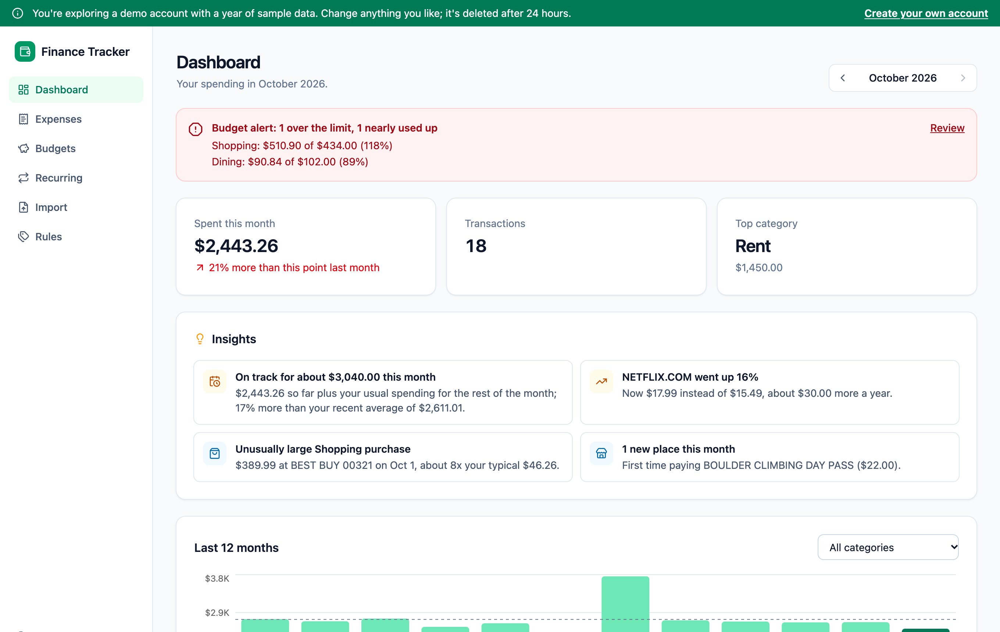
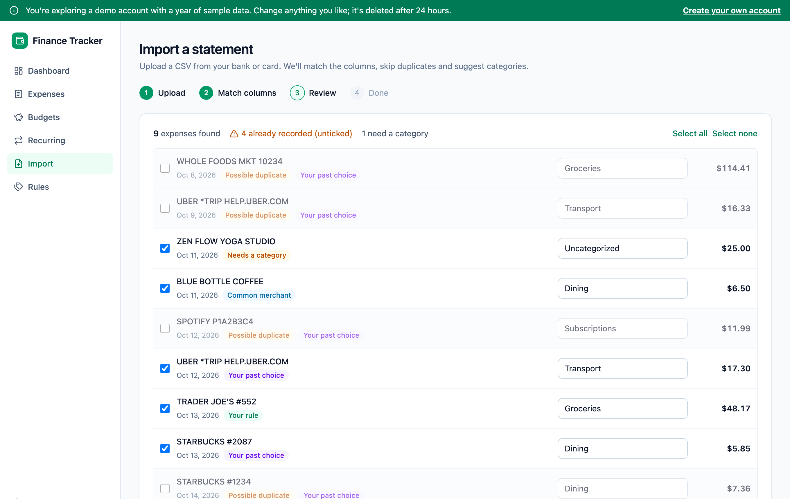
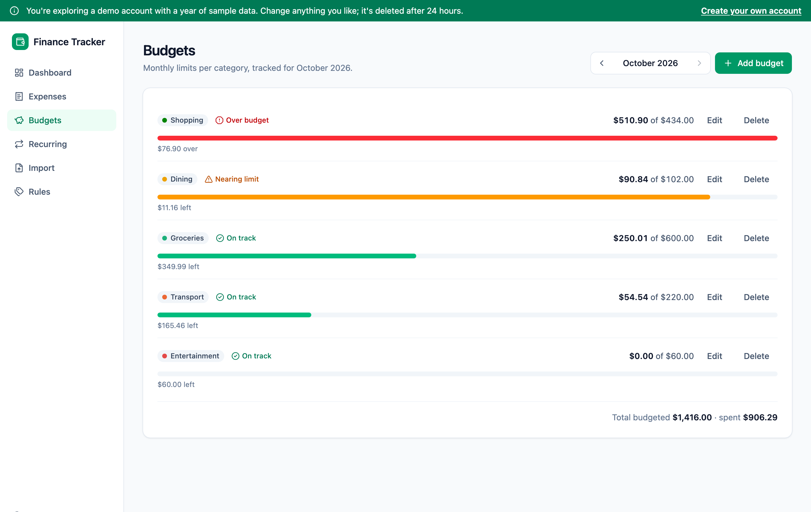
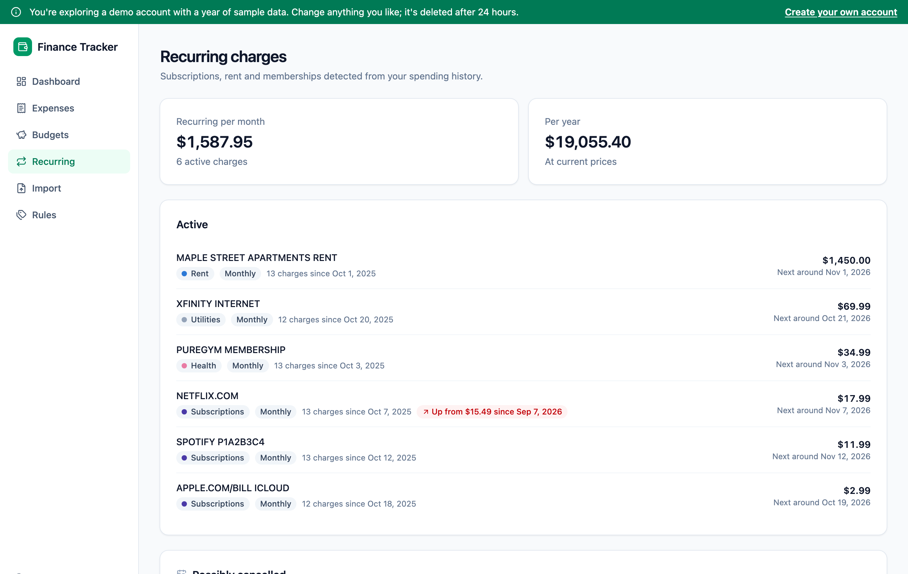
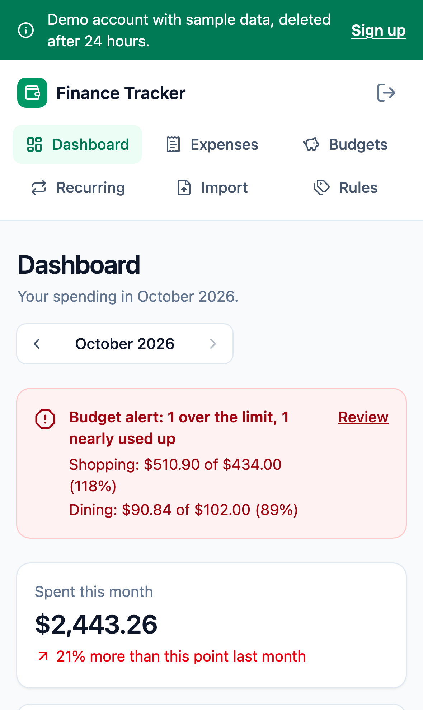
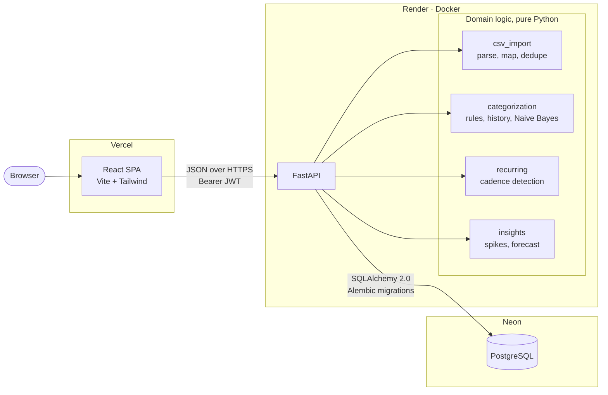

# Finance Tracker

[](https://github.com/Malak371/finance-tracker/actions/workflows/ci.yml)

**Import a bank statement and see where your money goes: duplicates skipped, every transaction categorised by rules and a model that learns from your corrections, and warnings before a budget runs out.**

**Live demo: [finance-tracker-and-manager.vercel.app](https://finance-tracker-and-manager.vercel.app)**

No sign-up needed. Click **Explore the live demo**, or go straight in with [/demo](https://finance-tracker-and-manager.vercel.app/demo). Each visitor gets a private account with a year of realistic data, so change anything you like; it's deleted after 24 hours.

> The API runs on Render's free tier, which sleeps after 15 minutes without traffic. The first request after that can take up to a minute while it wakes up; the app says so instead of hanging silently.



## Features

- **CSV statement import.** Upload an export from any bank or card, match the columns once, and review before saving.
  - Handles bank preamble lines, `,` `;` and tab delimiters, UTF-8 and Windows-1252 files, `1,234.56` / `1.234,56` / `(12.00)` amounts, and separate debit and credit columns.
  - Detects the date format from the data and asks when day/month order is ambiguous.
  - Flags transactions that are already recorded, so re-importing an overlapping statement doesn't create duplicates.
  - Income and refunds are skipped, with a reason for each skipped row.
- **Automatic categorisation that learns.** Your keyword rules, merchants you've categorised before, and a per-user Naive Bayes classifier trained on your corrections, with built-in merchant keywords as a fallback. Every suggestion shows where it came from. [How it works](#how-categorisation-works).
- **Budgets with alerts.** Monthly limits per category, progress bars, "nearing limit" at 80% and "over budget" states, a warning when this month's pace projects past the limit, and an alert banner on the dashboard.
- **Spending insights.** Plain-English cards that compare the month with your own history: category spikes and drops, unusually large purchases, new merchants, subscription price rises, and a month-end forecast.
- **Recurring charges.** Subscriptions, rent and memberships are detected from timing and amount (weekly to yearly), with the next expected date, price changes ("up from $15.49 since Jul 7") and charges that seem to have stopped.
- **Trends.** A 12-month spending chart (optionally per category), a category breakdown, and daily spending. The month in progress is compared with *the same point* last month.
- **Everything else you'd expect.** Add, edit and delete expenses; filter by month and category; export to CSV; works on phones.

| Import review | Budgets | Recurring charges |
| --- | --- | --- |
|  |  |  |

<p align="center"></p>

## Architecture



- **Frontend:** React 19 single-page app built with Vite. Data loading goes through a small `useApi` hook with loading, error and retry states.
- **Backend:** FastAPI. The interesting logic (CSV parsing, categorisation, recurring detection, insights) lives in pure modules with no database access, which keeps it easy to unit-test. Routes load data, call them, and save the results.
- **Database:** PostgreSQL, with the schema managed by Alembic migrations. Money is stored as `numeric(12,2)`.

## Tech stack

| Area | Tools |
| --- | --- |
| Frontend | React 19, Vite, Tailwind CSS 4, React Router 7, Recharts, Axios |
| Backend | Python 3.12, FastAPI, SQLAlchemy 2.0, Alembic, Pydantic 2, PyJWT, bcrypt |
| Database | PostgreSQL 17 |
| Testing | pytest (against real Postgres), Vitest + React Testing Library, Playwright |
| Quality | Ruff, ESLint, Prettier, GitHub Actions |
| Hosting | Vercel (frontend), Render (API, Docker), Neon (Postgres) |

## Run it locally

### With Docker (one command)

```bash
git clone https://github.com/Malak371/finance-tracker.git
cd finance-tracker
docker compose up --build
```

Then open:
- App: http://localhost:8080
- API docs: http://localhost:8000/docs

Migrations run automatically when the API starts. If those ports are taken, set other ones: `FRONTEND_PORT=3000 API_PORT=9000 docker compose up --build`.

### Without Docker

You need Python 3.12, Node 24 (see `frontend/.nvmrc`) and PostgreSQL.

**Backend:**

```bash
cd backend
python3.12 -m venv .venv && source .venv/bin/activate
pip install -r requirements-dev.txt
cp .env.example .env          # then set DATABASE_URL and JWT_SECRET
createdb finance_tracker
alembic upgrade head
uvicorn app.main:app --reload # http://localhost:8000
```

**Frontend** (in a second terminal):

```bash
cd frontend
npm ci
cp .env.example .env          # VITE_API_URL=http://localhost:8000
npm run dev                   # http://localhost:5173
```

### Configuration

All configuration comes from environment variables; see `backend/.env.example` and `frontend/.env.example`. No secrets are committed.

| Variable | Purpose |
| --- | --- |
| `DATABASE_URL` | Postgres connection string |
| `JWT_SECRET` | Token signing key, at least 32 characters. The API refuses to start without one |
| `CORS_ORIGINS` | Comma-separated list of allowed frontend origins |
| `ACCESS_TOKEN_EXPIRE_MINUTES` | Token lifetime (default 60) |
| `VITE_API_URL` | The API's URL, baked into the frontend build |

## Tests

| Suite | What it covers | Run it |
| --- | --- | --- |
| **Backend:** 149 pytest tests | Auth and token expiry or forgery, CRUD, validation, **user data isolation**, CSV parsing and duplicates, categorisation, recurring detection, insights, budgets, demo accounts, rate limits, security headers | `cd backend && pytest` |
| **Frontend:** 25 Vitest tests | Login, expense form, import review, budget alerts, landing page, route protection | `cd frontend && npm test` |
| **End-to-end:** 5 Playwright scenarios | Landing → demo → dashboard; importing a statement; sign up → budget → expense → log out → log in; mobile layout | `docker compose up -d` then `cd e2e && npx playwright test` |

The backend tests run against a real PostgreSQL database (set `TEST_DATABASE_URL`), and the schema is built by running the Alembic migrations, so the migrations are tested too. CI runs all three suites, plus Ruff, ESLint, Prettier and `alembic check`, on every push and pull request.

## Design decisions

### How categorisation works

Each imported transaction goes through these steps, and the first match wins:

1. **Your rules.** Keyword rules such as `trader joe` → Groceries. They match whole words, and the longest keyword wins, so `uber eats` beats `uber`.
2. **Your history.** If you've categorised the same merchant before (same words, ignoring reference numbers, so `STARBUCKS #1234` and `#5678` match), it gets your most recent choice.
3. **A classifier trained on your own data.** A multinomial Naive Bayes model over description words, with Laplace smoothing. It's trained only on categories *you* chose: typed by hand, corrected later, or from your bank's export. It needs at least 10 examples and only suggests at 70% confidence or more.
4. **Built-in merchant keywords.** A generic fallback (Netflix → Subscriptions).
5. **Uncategorized,** flagged for review.

Two choices matter here:
- **Your history and model come before the generic keywords.** If you always file Amazon under "Books", that should beat a default of "Shopping".
- **The model never learns from its own guesses.** Suggestions you accept unchanged aren't used as training data, which prevents a wrong guess from reinforcing itself. Changing a category, in the import review or later, marks it as yours.

The model is hand-written (about 40 lines in `backend/app/categorization.py`) rather than scikit-learn, which keeps the API image small and the logic easy to read.

### How user data isolation is enforced

- Every user-owned query goes through the `CurrentUser` dependency and filters on `user_id`. Single rows are only loaded through `get_owned_or_404`, so another user's ID returns exactly the same 404 as an ID that doesn't exist.
- A test **enumerates every endpoint from the OpenAPI schema** and fails if any non-public one answers without a token, so a new endpoint can't quietly skip auth. Further tests check that lists, totals, exports, insights, rules and duplicate detection never include another user's data.
- Foreign keys use `ON DELETE CASCADE`, so deleting a user (such as an expired demo account) removes their data with them.

### Duplicate detection

Imported rows are matched against existing expenses on (date, amount, normalised description), **by count**. If a file has two identical $3.50 coffees on the same day and one is already saved, only one is flagged. Re-imports and overlapping statements are caught, while genuine repeat purchases aren't hidden.

### Comparing like with like

A half-finished month always looks cheaper than a whole one. So the dashboard, the insights and the forecast compare the month in progress with earlier months **up to the same day**.

### Insights without false alarms

Insights compare you with your own six-month history and use deliberately conservative thresholds:
- A category spike must be at least 40% *and* $25 above average, *and* outside your normal variation (1.5 standard deviations).
- There are no category comparisons in the first week of a month.
- A single unusually large purchase isn't also reported as a category spike.

### Security

- Passwords are hashed with bcrypt. JWTs are signed with a secret that must come from the environment, and the API won't start without one.
- **Failed logins are rate-limited per email and per IP.** Response timing doesn't reveal whether an email is registered.
- Strict security headers on the API (including `Cache-Control: no-store` for financial data) and a Content-Security-Policy on the frontend.
- Every response has an `X-Request-ID`. Errors return it instead of internal details, and it matches a JSON access-log line.
- **Demo accounts** are created per visitor, can't log in with a password, are deleted after 24 hours, and their creation is rate-limited.

### Money

Amounts are `Decimal` in Python and `numeric(12,2)` in Postgres, never floats, so totals don't drift (0.10 + 0.20 is exactly 0.30). The API serialises them as JSON numbers for the frontend.

## Limitations and next steps

- **Rate limits are kept in memory.** That's fine for a single API instance; scaling out would need Redis.
- **The token is stored in `localStorage`.** Because the frontend and API are on different domains, httpOnly cookies would be third-party cookies, which Safari blocks. The strict CSP reduces the XSS risk this would otherwise carry.
- **Single currency.** Amounts are displayed in USD; multi-currency support would need exchange rates.
- **Ideas:** shared household budgets, receipt photo import, and natural-language questions about your spending.

## Project structure

```
backend/
  app/
    routes/            # HTTP layer: auth, expenses, budgets, imports, rules, insights, ...
    csv_import.py      # statement parsing, column mapping, duplicate detection
    categorization.py  # rules, history, Naive Bayes classifier
    recurring.py       # recurring charge detection
    insights.py        # spending insights and forecast
    demo.py            # demo account data
  alembic/             # migrations
  tests/
frontend/
  src/
    pages/             # Landing, Dashboard, Expenses, Budgets, Recurring, Import, Rules, ...
    components/
e2e/                   # Playwright tests
docker-compose.yml
render.yaml            # Render Blueprint for the API
```
